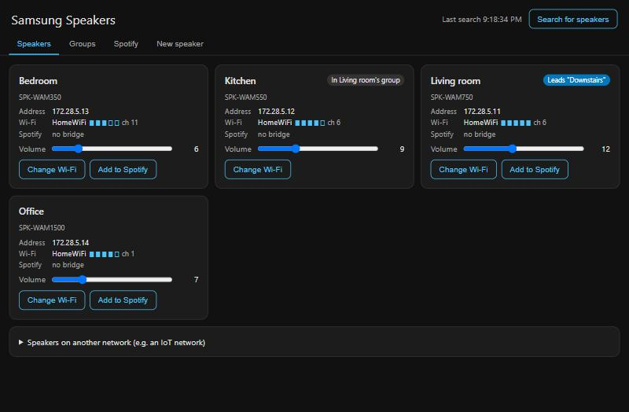
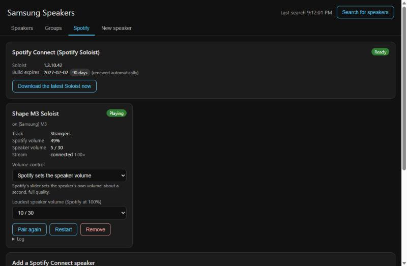
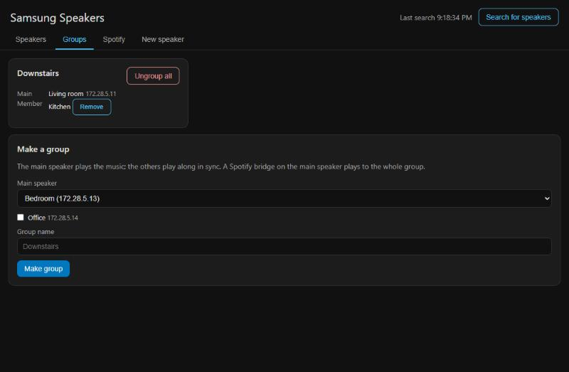

# Samsung Multiroom for Home Assistant

Keep Samsung Wireless Audio Multiroom speakers (Shape M3/M5/M7, Radiant
R1–R7) useful after Samsung abandoned its app and Spotify dropped the speakers'
built-in Spotify Connect ("no longer works with Spotify").

This is a **Home Assistant app repository**. Its app adds a **Samsung
Speakers** panel to Home Assistant's sidebar:

- **Speakers** – find speakers (also on other networks, such as an IoT VLAN),
  see their Wi-Fi network and signal, set the volume, move them to another
  Wi-Fi network.
- **Groups** – Samsung's own multiroom groups: the main speaker plays, the
  others follow in sync.
- **Spotify** – a Spotify Connect device per speaker or group, using
  [Spotify Soloist](https://developer.spotify.com/documentation/soloist),
  Spotify's official receiver. Pausing mutes the speaker at once, and Spotify's
  volume slider can set the speaker's own volume.
- **New speaker** – connect a speaker in setup mode to your Wi-Fi through the
  Home Assistant host's own Wi-Fi adapter.

  
  

  

## Install

1. Click the first badge: it opens the app in your Home Assistant and offers to
   add this repository if it isn't there yet. (The second badge only adds the
   repository.) Or do it by hand: **Settings → Apps → App store**, open the
   **⋮** menu → **Repositories**, and add
   `https://github.com/oskari/ha-samsung-multiroom`.
2. Install **Samsung Multiroom Speakers**. Home Assistant builds it on your
   machine, which takes a few minutes.
3. For Spotify: create a Soloist API key at
   <https://developer.spotify.com/dashboard/soloist> (needs Spotify Premium).
   In the app's **Configuration** tab, turn on **Accept Spotify's terms for
   Soloist** and paste the key.
4. **Start** the app and turn on **Show in sidebar**.
5. In the **Samsung Speakers** panel, open **Spotify** and add a bridge for a
   speaker. Then, on a phone or computer on the same network, pick it once in
   the Spotify app's **Devices** list to link it to your account.

## Requirements

- 64-bit Home Assistant (amd64 or aarch64, e.g. a Raspberry Pi 4/5 with a
  64-bit OS).
- Spotify Premium, for the Spotify bridges.
- Speakers on another network or VLAN must be allowed to reach the Home
  Assistant host on TCP 8099 (the audio stream port).
- Pairing a bridge needs the Spotify app on the same network as Home Assistant
  (or mDNS forwarded between the networks). A VPN on the pairing device can make
  pairing hang.
- **New speaker** setup needs a Wi-Fi adapter on the Home Assistant host that is
  not otherwise in use (e.g. the host is on Ethernet).

## Without Home Assistant

- `samsung_wam_wifi.py` – command-line tool for Wi-Fi setup and grouping
  (Python 3.10+, no dependencies). Run it without arguments for a guided mode.
  After `pip install -r requirements.txt` it opens a full-screen terminal UI
  (`wam_tui.py`). Joining a speaker's setup hotspot automatically needs Windows
  with a Wi-Fi adapter.
- A standalone Docker image of the app is planned.

## How it works

The speakers take XML commands as HTTP GETs on TCP 55001. Groups and Wi-Fi
setup use the speakers' own commands.

For Spotify, the app runs one Spotify Soloist instance per bridge, playing
into a private PulseAudio null sink. The app records that sink and serves it as
an endless WAV stream, which the speaker pulls after a `SetUrlPlayback`
command. Soloist's local WebSocket API tells the app when playback starts,
pauses or stops.

## Development

- `dev/run-local.ps1` – run the app container on its own in Docker Desktop
  (UI at <http://localhost:8098>), against real speakers.
- `dev/run-ha.ps1` – a throwaway Home Assistant with Supervisor, with this
  repository mounted as local apps, at <http://localhost:7123>.
  `python dev/ha_onboard.py` finishes its onboarding with a test account and
  checks the panel through ingress.
- `dev/run-demo.ps1` – four fake speakers (`dev/fake_speaker.py`), one group
  among them, and a copy of the app that only sees them, at
  <http://localhost:8097>. Used for the screenshots, and for trying groups
  without several real speakers.

## Credits

This project builds on what others found out about these speakers. These
sources provided protocol information; no code is copied from them.

- [pywam](https://github.com/Strixx76/pywam) (MIT) – Python library for
  the speakers. Command formats such as `SetUrlPlayback`, `SetMultispkGroup`,
  `GetMainInfo` and `SetVolume`, and the HTTP request headers on TCP 55001.
  Its sibling [samsungwam](https://github.com/Strixx76/samsungwam) (MIT) is
  the Home Assistant integration built on it.
- [wambridge](https://github.com/travnie/wambridge) (ISC) – its
  [protocol notes](https://github.com/travnie/wambridge/blob/main/docs/WAM_PROTOCOL.md),
  measured on a Shape M5, shaped the streaming design: an endless WAV stream
  with `0xFFFFFFFF` sizes pulled via `SetUrlPlayback`, one stream connection at
  a time, never a faked `Content-Length`, `<pwron>on</pwron>` on volume
  commands, raw volume 0 to pause, and the lag before audio is heard. They also
  list the Wi-Fi setup commands (`SetAp`, `SetApManual`).
- [WAM_API_DOC](https://github.com/bacl/WAM_API_DOC) – community documentation
  of the speaker API methods.
- [samsung_multiroom](https://github.com/krygal/samsung_multiroom) (MIT) – an
  earlier Python client for the same API.

See also [Music Assistant's Samsung WAM support](https://www.music-assistant.io/player-support/samsung-wam/),
an alternative if you already use Music Assistant.

## Not affiliated

Not affiliated with or endorsed by Samsung or Spotify. Spotify Soloist is not
part of this repository: the app downloads it from Spotify, and you use it
under Spotify's terms. "Samsung" and "Spotify" are trademarks of their owners.

## License

[MIT](LICENSE)
